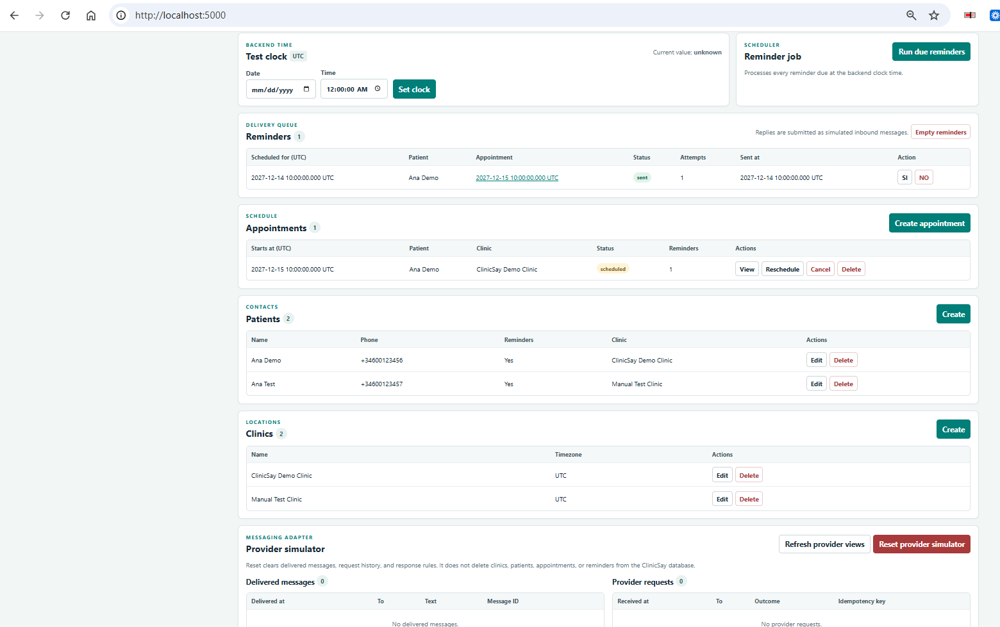
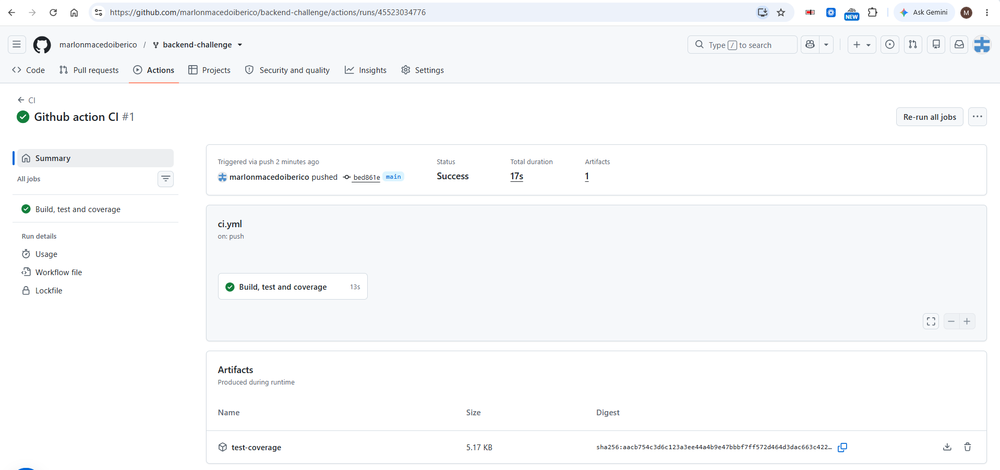
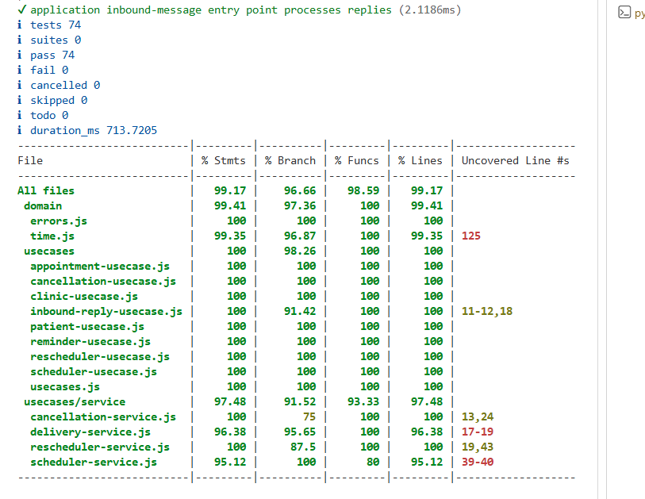

# Backend de ClinicSay

Entrega el reto mediante el formulario de Google Forms.
El plazo vence el miércoles, 25 de noviembre de 2026, a las 17:30, hora de
Madrid (11:30, hora de Lima).

Este backend implementa el reto de recordatorios de citas de ClinicSay.
El enunciado está en [`enunciado.pdf`](enunciado.pdf), y
[`openapi.yaml`](openapi.yaml) define el contrato HTTP. Los requisitos y las
decisiones de diseño del producto están en `.ai/steering/` y `.ai/specs/`.

## Decisiones de arquitectura

### Arquitectura

Para el alcance actual del challenge, un backend monolítico es suficiente. Esta
decisión mantiene sencillo el despliegue y permite concentrar el esfuerzo en
resolver los requisitos del producto.

La estructura sigue los principios de Clean Architecture para distinguir con
claridad los casos de uso, los endpoints, los servicios y los repositorios.
Los casos de uso coordinan el flujo de negocio; el dominio y los servicios de
aplicación dependen de puertos, mientras PostgreSQL y el proveedor HTTP actúan
como adaptadores. Esta separación facilita comprender cada operación, mantener
el código y probar sus componentes de forma independiente.

## Tratamiento de las zonas horarias

La conversión entre la hora local de la clínica y un instante UTC está
centralizada en [`src/domain/time.ts`](src/domain/time.ts). En un día normal,
la hora local existe una sola vez y se convierte directamente al instante
correspondiente, sin modificar sus componentes horarios.

En los cambios de horario de verano (DST), una hora local puede repetirse o no
existir:

- **Atraso del reloj en otoño:** si una hora ocurre dos veces, se elige el
  instante más temprano, correspondiente a la primera aparición de esa hora.
- **Adelanto del reloj en primavera:** si el salto hace que una hora local no
  exista, se avanza por la duración del salto. Por ejemplo, si el reloj pasa de
  las 02:00 a las 03:00, las 02:30 se resuelven como las 03:30.

## Envíos únicos

Para reducir los envíos duplicados, los recordatorios salientes cuentan con
dos protecciones complementarias:

- **Reclamo atómico del recordatorio:** PostgreSQL selecciona los recordatorios
  pendientes con `FOR UPDATE SKIP LOCKED`, evitando que dos trabajadores
  reclamen el mismo registro a la vez. Al reclamarlos, actualiza su estado a
  `sending` e incrementa el número de intentos. Esto ocurre en
  [`postgres-repository.ts:85`](src/infrastructure/postgres/postgres-repository.ts:85)
  y [`postgres-repository.ts:91`](src/infrastructure/postgres/postgres-repository.ts:91).
- **Clave de idempotencia estable:** cada intento de envío usa el ID del
  recordatorio como clave. Los reintentos conservan el mismo ID y el proveedor
  recibe la clave en el encabezado `Idempotency-Key`. El ID se asigna en
  [`delivery-service.ts:67`](src/usecases/service/delivery-service.ts:67)
  y el encabezado se envía en
  [`http-message-provider.ts:19`](src/infrastructure/messaging/http-message-provider.ts:19).

La segunda protección depende de que el proveedor respete la clave de
idempotencia; por sí sola, la aplicación no puede garantizar una entrega
exactamente una vez.

Los mensajes entrantes duplicados se descartan con `message_id` como clave
primaria. Además, la base de datos impide crear más de un recordatorio para la
misma versión de una cita:

- [`postgres-repository.ts:390`](src/infrastructure/postgres/postgres-repository.ts:390)
  ignora los mensajes entrantes cuyo `message_id` ya existe.
- [`001_initial_schema.sql:49`](migrations/001_initial_schema.sql:49)
  declara `message_id` como clave primaria.
- [`001_initial_schema.sql:42`](migrations/001_initial_schema.sql:42)
  establece la restricción única sobre `(appointment_id, appointment_version)`.

## Servicios locales

Se necesita Docker Desktop con Docker Compose. Para compilar e iniciar la API,
PostgreSQL y el simulador de mensajería incluido:

```sh
docker compose up --build
```

En el Símbolo del sistema de Windows (`cmd.exe`):

```cmd
docker compose up --build
```

La API escucha en `http://localhost:3000`, el simulador del proveedor en
`http://localhost:4010` y PostgreSQL en `localhost:5433`. La API ejecuta las
migraciones de la base de datos antes de empezar a escuchar. Comprueba que esté
lista con `GET http://localhost:3000/health`.

La configuración local de Compose usa `CLOCK_MODE=test`, por lo que puedes
ajustar la hora del backend con `PUT /test/clock`. Si no se define
`CLOCK_MODE=test`, el backend usa el reloj del sistema en UTC y el endpoint
para ajustar la hora no está disponible. Este ajuste solo afecta al backend;
la hora que muestra el dispositivo queda fuera del alcance de esta API.

Variables locales:

- `PORT`: `3000`; puerto HTTP.
- `CLOCK_MODE`: `test`; habilita el reloj ajustable del backend.
- `DEBUG_TIME`: `0`; usa `1` para mostrar las comprobaciones de zona horaria,
  los desfases, los instantes candidatos y las coincidencias exactas.
- `PROVIDER_URL`: `http://provider:4010`; URL del proveedor desde el contenedor
  de la API.
- `DATABASE_URL`: conexión de PostgreSQL:
  `postgresql://clinicsay:clinicsay@db:5432/clinicsay`.

Para activar los registros de depuración de hora desde CMD, define la variable
antes de iniciar Compose:

```cmd
set "DEBUG_TIME=1"
docker compose up --build
```

Los mensajes aparecen en la salida del contenedor de la API. Si el stack está
ejecutándose en segundo plano, puedes seguirlos con:
`docker compose logs -f api`.

Detén el stack con `docker compose down`. Los datos de PostgreSQL se conservan
en su volumen.

En CMD, usa:

```cmd
docker compose down
```

## Interfaz de prueba

El directorio [`frontend/`](frontend/) contiene una interfaz local para probar
la API y el simulador del proveedor. Para instalarla y ejecutarla, sigue las
instrucciones de su [README](frontend/README.md).



## Pruebas y cobertura

Se necesita Node.js 22 o posterior y npm. Instala las dependencias y ejecuta
las pruebas unitarias:

```sh
npm install
npm test
```

En el Símbolo del sistema de Windows (`cmd.exe`):

```cmd
npm install
npm test
```

Las pruebas usan el ejecutor integrado `node:test` de Node.js y cubren
`SchedulerService`, `DeliveryService` (incluidos los reintentos),
`ReschedulerService`, `CancellationService` y el procesamiento de respuestas
entrantes.

Para ver los registros de depuración de zonas horarias en todas las pruebas unitarias, usa CMD:

```cmd
set "DEBUG_TIME=1"
npm run build
node --test dist/tests/unit/*.test.js
```

Define `DEBUG_TIME` antes de iniciar Node, porque `time.ts` lee la variable
cuando se carga el módulo. La prueba mostrará las muestras de hora y sus
desfases, los instantes candidatos y las coincidencias exactas.

Para ejecutar las pruebas y generar los informes de cobertura:

```sh
npm run test:coverage
```

En el Símbolo del sistema de Windows (`cmd.exe`):

```cmd
npm run test:coverage
```

El comando muestra un resumen de cobertura y genera estos archivos:

- `coverage/index.html`: informe navegable con cobertura de archivos, líneas,
  ramas y funciones.
- `coverage/lcov.info`: datos LCOV para CI y herramientas de análisis de
  cobertura.

Abre `coverage/index.html` en un navegador para consultar el informe. La
compilación de TypeScript genera sus archivos en `dist/`.

Usa `npm run test:coverage:usecases` para exigir al menos 95% de cobertura de lineas, funciones, ramas y sentencias en los modulos de casos de uso.

### Integración continua

GitHub Actions ejecuta la compilación, las pruebas y la cobertura al subir
cambios, abrir o actualizar una solicitud de cambios, o iniciar el workflow
manualmente desde la pestaña **Actions**. El informe HTML y el archivo LCOV
quedan disponibles como artefacto durante 14 días.



Ejemplos del informe de cobertura:




## Notas de implementación

- La planificación de recordatorios y la hora de las citas usan la zona IANA
  de la clínica cuando corresponde. La API devuelve las marcas de tiempo como
  instantes UTC.
- El simulador del proveedor en `provider/` es fijo para la evaluación y no
  debe modificarse.

## Lo que se agregó, lo que se dejó y lo que haría con más tiempo

### Lo que se agregó

Se incorporó un frontend de prueba en [`frontend/`](frontend/) para explorar
los flujos de la API. Para respaldarlo, se añadieron operaciones CRUD para las
distintas entidades del dominio.

### Lo que se dejó fuera

La lógica de envío se mantuvo en la aplicación, sin incorporar un motor de
reglas de negocio como Drools para Java o GoRules Zen Engine para Node.js.

### Qué haría con más tiempo

Si ClinicSay aumenta el volumen de citas, procesa más recordatorios en paralelo
o incorpora nuevos canales de comunicación, separaría el registro de citas del
despacho de mensajes. El patrón **Transactional Outbox** permitiría guardar la
operación de negocio y la instrucción de enviar el recordatorio dentro de la
misma transacción. Así, el envío pendiente no dependería únicamente de la
memoria de un proceso que podría fallar.

## Cómo se llevaría a producción a mayor escala

Empezaría con una API desplegada en la nube, PostgreSQL administrado y un
proveedor oficial de WhatsApp. Guardaría las credenciales en un gestor de
secretos y configuraría copias de seguridad periódicas.

Adoptaría definitivamente el patrón **Transactional Outbox** mencionado antes: la operación de negocio y la instrucción de envío se guardarían en la misma transacción de PostgreSQL. Así, el despacho no dependería únicamente de la memoria de un proceso.

Los recordatorios pendientes permanecerían registrados en PostgreSQL y varios
trabajadores los enviarían en segundo plano. Para un volumen de 20 000
recordatorios diarios, empezaría con pocos trabajadores y ajustaría su capacidad
según la carga observada. Si el crecimiento lo justifica, incorporaría una cola
externa —por ejemplo, Amazon SQS o RabbitMQ— para distribuir el trabajo y
absorber picos de actividad.

El lanzamiento sería gradual: probaría primero con pocas clínicas y aumentaría
el volumen progresivamente, respetando los límites de envío de WhatsApp.

Monitorizaría el volumen pendiente, los retrasos, los errores, los reintentos y
las respuestas del proveedor. Configuraría alertas ante retrasos crecientes,
fallos frecuentes o falta de respuesta de la API. Revisaría las métricas y los
costes para decidir cuándo ampliar la capacidad.

## Sobre el uso de la IA

Utilicé IA durante todo el ciclo de creación del software: desde la ideación del producto y la definición de requisitos (consistencia, completitud y detección de brechas), hasta el diseño, la creación de tareas de implementación y la implementación.

Si las fases previas a la implementación están claras y los agentes tienen roles bien definidos —por ejemplo, arquitecto, solution designer o backend engineer con experiencia en Clean Architecture—, la implementación normalmente funciona. Después dediqué más tiempo a dar un toque más humano a los escenarios de prueba, mejorar la documentación, revisar si cada archivo estaba donde debía estar dentro de Clean Architecture y refactorizar. En el diseño también es importante que los servicios queden bien definidos.

Seguí la metodología Spec-Driven Development (SDD); la metodología está descrita en `.ai/docs/`. Los documentos completados están en `.ai/`

En resumen, pasé entre 7 y 9 horas especificando y planificando, unos 5 minutos implementando y entre 2 y 3 horas revisando lo generado y resolviendo o refactorizando el código.

En mi experiencia anterior, la distribución era 20 % para specs, design and planning, y 80 % para coding/testing. Con IA, la proporción se invirtió.