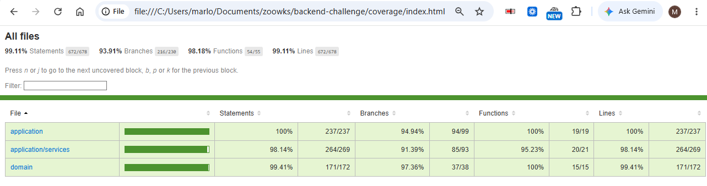

# Backend de ClinicSay

Entrega el reto mediante el formulario de Google Forms.
El plazo vence el miércoles, 25 de noviembre de 2026, a las 17:30, hora de
Madrid (11:30, hora de Lima).

Este backend implementa el reto de recordatorios de citas de ClinicSay.
El enunciado está en [`enunciado.pdf`](enunciado.pdf), y
[`openapi.yaml`](openapi.yaml) define el contrato HTTP. Los requisitos y las
decisiones de diseño del producto están en `.ai/steering/` y `.ai/specs/`.

## Servicios locales

Se necesita Docker Desktop con Docker Compose. Para compilar e iniciar la API,
PostgreSQL y el simulador de mensajería incluido:

```sh
docker compose up --build
```

En el Símbolo del sistema de Windows (`cmd.exe`):

```cmd
docker compose up --build
```

La API escucha en `http://localhost:3000`, el simulador del proveedor en
`http://localhost:4010` y PostgreSQL en `localhost:5433`. La API ejecuta las
migraciones de la base de datos antes de empezar a escuchar. Comprueba que esté
lista con `GET http://localhost:3000/health`.

La configuración local de Compose usa `CLOCK_MODE=test`, por lo que puedes
ajustar la hora del backend con `PUT /test/clock`. Si no se define
`CLOCK_MODE=test`, el backend usa el reloj del sistema en UTC y el endpoint
para ajustar la hora no está disponible. Este ajuste solo afecta al backend;
la hora que muestra el dispositivo queda fuera del alcance de esta API.

Variables locales:

- `PORT`: `3000`; puerto HTTP.
- `CLOCK_MODE`: `test`; habilita el reloj ajustable del backend.
- `DEBUG_TIME`: `0`; usa `1` para mostrar las comprobaciones de zona horaria,
  los desfases, los instantes candidatos y las coincidencias exactas.
- `PROVIDER_URL`: `http://provider:4010`; URL del proveedor desde el contenedor
  de la API.
- `DATABASE_URL`: conexión de PostgreSQL:
  `postgresql://clinicsay:clinicsay@db:5432/clinicsay`.

Para activar los registros de depuración de hora desde CMD, define la variable
antes de iniciar Compose:

```cmd
set "DEBUG_TIME=1"
docker compose up --build
```

Los mensajes aparecen en la salida del contenedor de la API. Si el stack está
ejecutándose en segundo plano, puedes seguirlos con:
`docker compose logs -f api`.

Detén el stack con `docker compose down`. Los datos de PostgreSQL se conservan
en su volumen.

En CMD, usa:

```cmd
docker compose down
```

## Pruebas y cobertura

Se necesita Node.js 22 o posterior y npm. Instala las dependencias y ejecuta
las pruebas unitarias:

```sh
npm install
npm test
```

En el Símbolo del sistema de Windows (`cmd.exe`):

```cmd
npm install
npm test
```

Las pruebas usan el ejecutor integrado `node:test` de Node.js y cubren
`SchedulerService`, `DeliveryService` (incluidos los reintentos),
`ReschedulerService`, `CancellationService` y el procesamiento de respuestas
entrantes.

Para ver los registros de depuración de zonas horarias mientras ejecutas solo
la prueba de conversión de hora, usa CMD:

```cmd
set "DEBUG_TIME=1"
npm run build
node --test dist/tests/unit/time.test.js
```

Define `DEBUG_TIME` antes de iniciar Node, porque `time.ts` lee la variable
cuando se carga el módulo. La prueba mostrará las muestras de hora y sus
desfases, los instantes candidatos y las coincidencias exactas.

Para ejecutar las pruebas y generar los informes de cobertura:

```sh
npm run test:coverage
```

En el Símbolo del sistema de Windows (`cmd.exe`):

```cmd
npm run test:coverage
```

El comando muestra un resumen de cobertura y genera estos archivos:

- `coverage/index.html`: informe navegable con cobertura de archivos, líneas,
  ramas y funciones.
- `coverage/lcov.info`: datos LCOV para CI y herramientas de análisis de
  cobertura.

Abre `coverage/index.html` en un navegador para consultar el informe. La
compilación de TypeScript genera sus archivos en `dist/`.

Ejemplos del informe de cobertura:




## Notas de implementación

- La aplicación sigue Clean Architecture. El dominio y los servicios de
  aplicación dependen de puertos; PostgreSQL y el proveedor HTTP son
  adaptadores de infraestructura.
- La planificación de recordatorios y la hora de las citas usan la zona IANA
  de la clínica cuando corresponde. La API devuelve las marcas de tiempo como
  instantes UTC.
- El simulador del proveedor en `provider/` es fijo para la evaluación y no
  debe modificarse.
