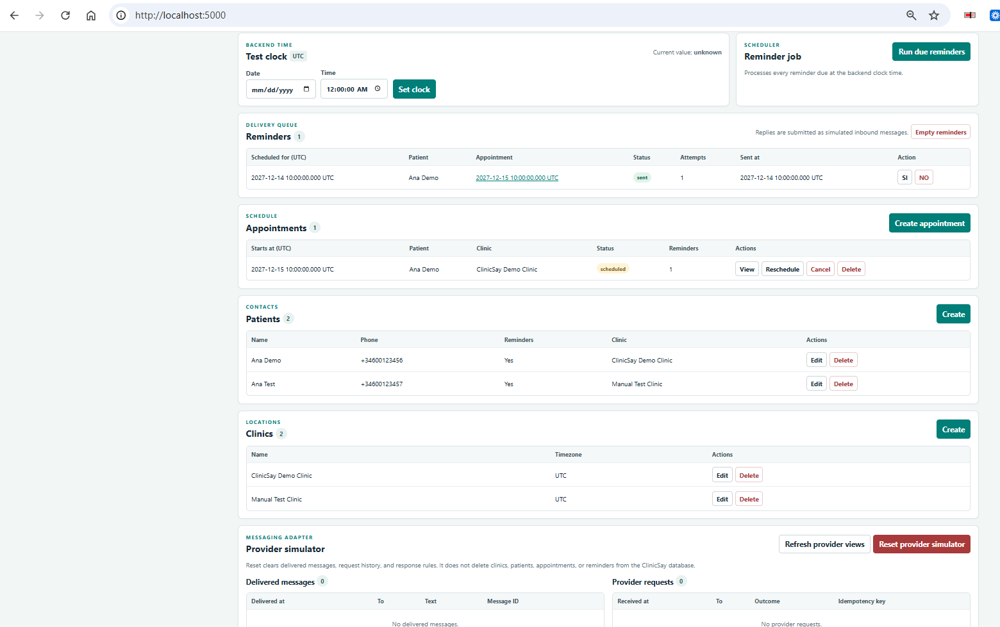

# ClinicSay test console

A local Flask interface for exercising the ClinicSay API and its provider simulator. The browser talks only to Flask; Flask sends API requests server side. Keep this tool on your development machine because the API does not currently provide authentication.

## Requirements and setup

- Python 3.10 or newer
- The ClinicSay Docker Compose stack running with `CLOCK_MODE=test`

From the repository root, start the backend stack:

```sh
docker compose up --build
```

In another terminal, install and start the frontend:

```sh
cd frontend
python -m venv .venv
```

Activate the environment (`.venv\Scripts\activate.bat` in DOS Command Prompt, `.venv\Scripts\Activate.ps1` in Windows PowerShell, or `source .venv/bin/activate` on macOS/Linux), then run:

```sh
python -m pip install -r requirements.txt
python app.py
```

Open <http://127.0.0.1:5000>. The API base URL defaults to `http://localhost:3000`; override it with `API_BASE_URL` if needed. Optional `FLASK_HOST` and `FLASK_PORT` variables control the local web server address and port.

## Walkthrough



1. Create a clinic and enter its IANA timezone, such as `Europe/Madrid`.
2. Create a patient for that clinic. A valid E.164 phone number is needed for reminder delivery and simulated replies. **Accepts reminders** defaults to Yes.
3. Create an appointment with a future UTC date and time. The UI submits a timezone-aware ISO 8601 timestamp ending in `Z`.
4. Set the backend test clock to a UTC time at or after the reminder's scheduled time, then choose **Run due reminders**.
5. Refresh to inspect reminder state, delivered messages, and provider request outcomes. Use **SI** or **NO** to submit a simulated inbound reply. The confirmed **Delete** action removes an appointment and its reminders; **Empty reminders** clears reminder records across all appointments.

The clock control requires the backend to run with `CLOCK_MODE=test`. The clock is unknown on initial load because the API does not expose a read operation. Resetting the provider simulator clears only its messages, request history, and response rules; it does not remove ClinicSay records. To remove clinics or patients, first clear appointments as needed to satisfy their reference constraints.
